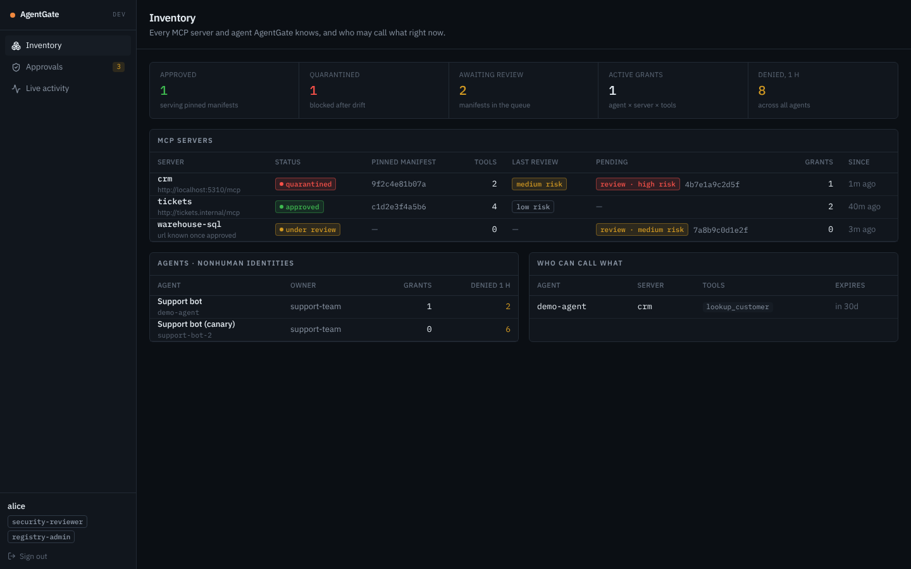

# AgentGate

**Governance control plane for AI agents' tool access over MCP.**

AI agents increasingly act through MCP servers: CRM lookups, ticketing, databases. An MCP server that is trusted today can quietly change its tool descriptions tomorrow (a "rug pull"). A prompt-injected agent can start calling tools it was never meant to use. AgentGate puts a lifecycle around that access:

```
discover → risk-scan → approve (four-eyes) → pin manifest → enforce per-agent grants at a gateway
        → detect drift / anomalies → quarantine server / suspend grant → re-review
```

## Architecture

| Service | Owns |
|---|---|
| **Registry** | MCP servers, pinned tool manifests (SHA-256), agents as nonhuman identities, drift detection |
| **Review** | Risk scans, four-eyes approval, grants (agent × server × tools) |
| **Gateway** | MCP enforcement proxy (YARP): answers `tools/list` from the pinned manifest, checks grants on `tools/call`, detects anomalies |
| **Hub** | Read model built only from events: inventory, who can call what, audit timeline, live activity feed |

**How the services talk:**
- **Events:** RabbitMQ via MassTransit, with a transactional outbox and inbox.
- **gRPC:** one code-first call, used only where a check must be authoritative at the moment of a state transition.
- **Identity:** Keycloak (OIDC); agents authenticate with client credentials.

**Stack:** .NET 10, Aspire, Postgres, OpenTelemetry. Console: React, TypeScript, Vite, TanStack Query and Router, Tailwind.

**Further reading:**
- Design: [docs/plan.md](docs/plan.md)
- Decisions: [docs/adr](docs/adr)

## Console

A security-operations console. It is dark and dense, and colour appears only where it signals status, risk or a decision.

| Screen | Contents |
|---|---|
| **Inventory** | Servers with their status, last review risk and any pending re-review; agents; who can call what right now |
| **Approvals** | The review queue and grant requests. Two different reviewers must approve: the person who gave the first approval can't give the second. |
| **Review** | Scanner findings with the text that triggered them, the manifest diff rendered like a code review, the decision and the audit trail |
| **Live activity** | Every gateway decision and governance event, streamed over SSE, with denial spikes per agent highlighted |
| **Server / agent** | Pinned tools, grants (suspend, resume, revoke), timeline, recent calls |

The re-review a rug pull triggers: the hidden instructions show up in the scan findings and in the diff.


| Inventory | Live activity |
|---|---|
|  |  |

<sub>Screenshots come from the Playwright suite (`web/e2e`), which runs the console against fixed data.</sub>

## Status

| Milestone | Scope | State |
|---|---|---|
| M0 | Repo, BuildingBlocks, Aspire AppHost, architecture tests, CI | done |
| M1 | Gateway enforcement + demo MCP server and agent | done |
| M2 | Registry: manifest pinning, drift → quarantine | done |
| M3 | Review: risk scan, four-eyes, grants, gRPC check | done |
| M4 | Hub + React console | done |
| M5 | Anomaly auto-suspend, Claude risk scanner, demo | next |

## Run

Requirements:
- .NET 10 SDK;
- Node.js 22 or newer, for the console;
- Docker Desktop, for the AppHost's containers (Postgres, RabbitMQ, Keycloak).

```bash
dotnet test
dotnet run --project src/AgentGate.AppHost
```

Steps once the AppHost is running:
1. Open the console at http://localhost:5173.
2. Sign in with one of the dev accounts from the realm import. The password is the username followed by `-dev`; for example, alice signs in with `alice-dev`.

| User | Role |
|---|---|
| `alice`, `bob` | security reviewers (use both to see four-eyes) |
| `carol` | registry admin (registers, requests grants) |
| `dave` | auditor (read-only) |

3. To play the scripted scenario, start `demo-agent` from the Aspire dashboard.

To work on the console alone:

```bash
cd web && npm ci && npm test && npm run screenshots
```
